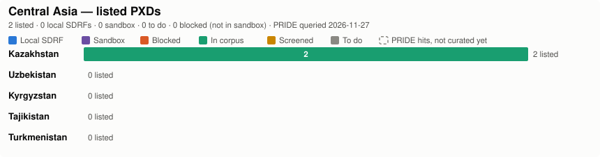

# Central Asia — scoped

Generated by `scripts/update_status.py`; PRIDE hits queried 2026-11-28. Region overview below; per-country city charts are linked under it.

### Central Asia — listed PXDs

Per-country pages: [Country status pages](status/markdowns/)

### Countries

- [Kazakhstan](kazakhstan.md) — scoped
- [Uzbekistan](uzbekistan.md) — not started
- [Kyrgyzstan](kyrgyzstan.md) — not started
- [Tajikistan](tajikistan.md) — not started
- [Turkmenistan](turkmenistan.md) — not started
