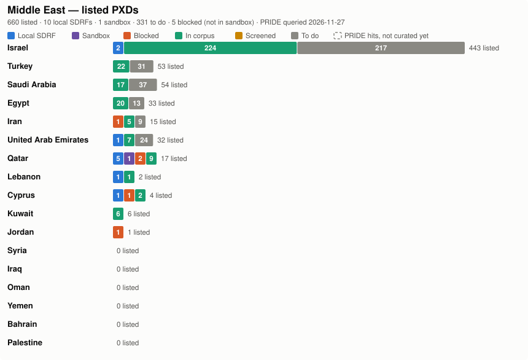

# Middle East — in progress

Generated by `scripts/update_status.py`; PRIDE hits queried 2026-11-28. Region overview below; per-country city charts are linked under it.

### Middle East — listed PXDs

Per-country pages: [Country status pages](status/markdowns/)

### Countries

- [Israel](israel.md) — in progress
- [Turkey](turkey.md) — scoped
- [Saudi Arabia](saudi_arabia.md) — scoped
- [Egypt](egypt.md) — scoped
- [Iran](iran.md) — in progress
- [United Arab Emirates](uae.md) — in progress
- [Qatar](qatar.md) — in progress
- [Lebanon](lebanon.md) — in progress
- [Cyprus](cyprus.md) — in progress
- [Kuwait](kuwait.md) — scoped
- [Jordan](jordan.md) — in progress
- [Syria](syria.md) — not started
- [Iraq](iraq.md) — not started
- [Oman](oman.md) — not started
- [Yemen](yemen.md) — not started
- [Bahrain](bahrain.md) — not started
- [Palestine](palestine.md) — not started
