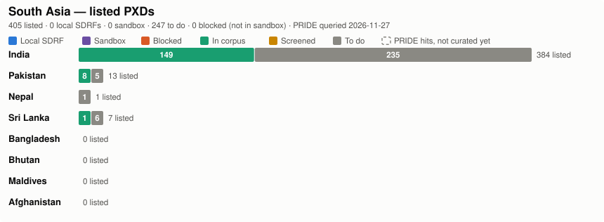

# South Asia — in progress

Generated by `scripts/update_status.py`; PRIDE hits queried 2026-11-28. Region overview below; per-country city charts are linked under it.

### South Asia — listed PXDs

Per-country pages: [Country status pages](status/markdowns/)

### Countries

- [India](india.md) — in progress
- [Pakistan](pakistan.md) — in progress
- [Nepal](nepal.md) — in progress
- [Sri Lanka](sri_lanka.md) — in progress
- [Bangladesh](bangladesh.md) — not started
- [Bhutan](bhutan.md) — not started
- [Maldives](maldives.md) — not started
- [Afghanistan](afghanistan.md) — not started
